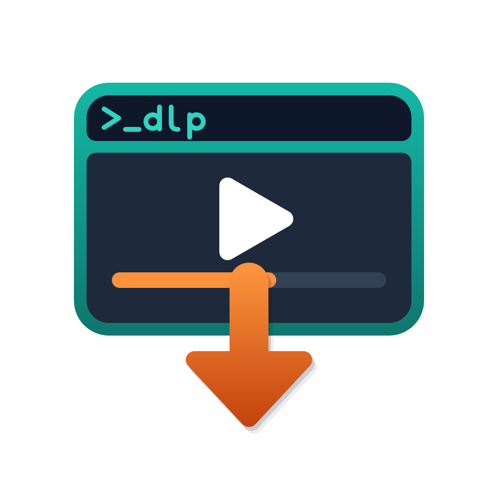
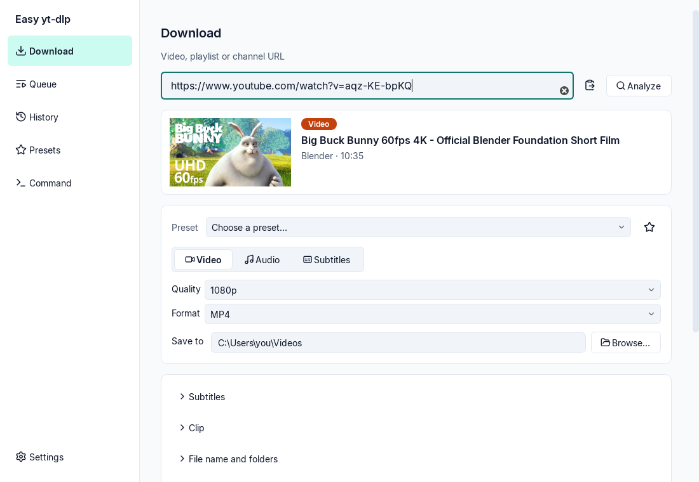
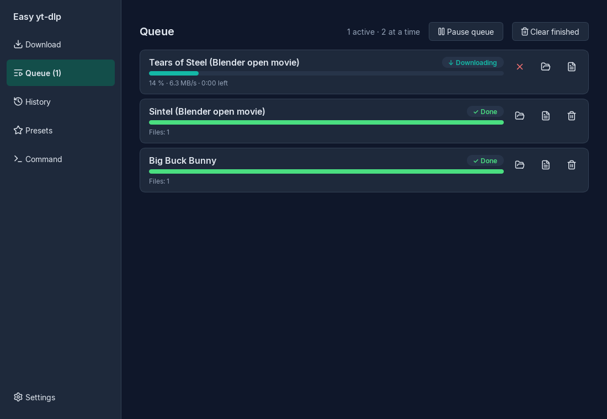
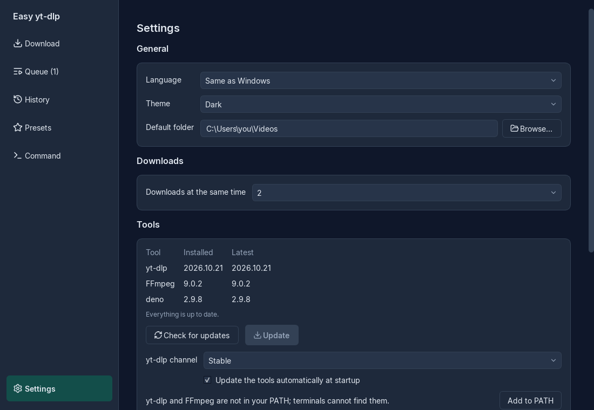

<p align="center">
  
</p>

<h1 align="center">Easy yt-dlp</h1>

<p align="center">A Windows desktop app that makes <a href="https://github.com/yt-dlp/yt-dlp">yt-dlp</a> easy to install, use and keep up to date.</p>

<p align="center">
  <a href="https://github.com/asansil/easy-yt-dlp/releases/latest"></a>
  <a href="https://github.com/asansil/easy-yt-dlp/actions/workflows/ci.yml"></a>
  <a href="LICENSE"></a>
  <a href="#requirements"></a>
  <a href="#building-from-source"></a>
  <a href="https://github.com/yt-dlp/yt-dlp"></a>
</p>



## Overview

yt-dlp can download from thousands of sites, but it is a command-line program: you install it, keep it and FFmpeg updated, and remember the right options. Easy yt-dlp wraps it in a graphical interface for people who would rather click than type, while keeping every yt-dlp option within reach.

It installs and updates yt-dlp, FFmpeg and deno for you, verifies every file it downloads, and shows the exact yt-dlp command behind each download. The downloads themselves are done by yt-dlp, so site support and fixes arrive with yt-dlp's own updates.

## Features

- **Video and audio**: pick the quality and container (MP4, MKV, WebM), or extract audio as MP3, M4A, Opus, FLAC or WAV at a chosen bitrate.
- **Playlists and channels**: choose which items to download, with search and ranges such as `1-5, 8, 10-`.
- **Subtitles**: choose languages, include auto-generated ones, embed them in the video or save separate files, or download subtitles only.
- **Clips**: download only part of a video or audio, from a start time to an end time.
- **File names and folders**: templates with a live preview, and optional subfolders per uploader or playlist.
- **Queue**: parallel downloads with progress, speed, time left, cancel, retry and logs.
- **History and presets**: search past downloads and download them again; save option sets as presets (six are built in).
- **Advanced options**: cookies from your browser, embedded metadata, thumbnails and chapters, [SponsorBlock](https://sponsor.ajay.app/), rate limit, download archive and extra yt-dlp arguments.
- **Command mode**: "Show command" displays the yt-dlp command for the current options, and the Command page runs any yt-dlp arguments you type.
- **Interface**: English and Spanish, light and dark themes that follow Windows, full keyboard navigation.

## Requirements

| | |
|---|---|
| Operating system | Windows 10 or 11, 64-bit (tested on Windows 11) |
| Disk space | About 400 MB: the app (about 70 MB) plus yt-dlp, FFmpeg and deno (about 310 MB) |
| Internet | Needed on first run to download the tools (about 180 MB), and to download media |
| Administrator rights | Not needed |

## Installation

1. Download `EasyYtDlp-Setup-<version>.exe` from the [latest release](https://github.com/asansil/easy-yt-dlp/releases/latest).
2. Run it. Windows may show **"Windows protected your PC"** because the installer is not code-signed yet: click **More info**, then **Run anyway**.
3. Keep **"Add yt-dlp and FFmpeg to the PATH"** checked if you also want to use them from a terminal.
4. On first launch, click **Install** to download yt-dlp, FFmpeg and deno.

To check that the installer is the one published, compare its SHA-256 with the `.sha256` file attached to the same release:

```powershell
(Get-FileHash .\EasyYtDlp-Setup-2.0.0.exe -Algorithm SHA256).Hash
```

## Usage

1. Copy a video, playlist or channel URL and paste it in the **Download** page (<kbd>Ctrl</kbd>+<kbd>V</kbd>). The app analyzes it and shows its title, thumbnail and available qualities.
2. Choose **Video**, **Audio** or **Subtitles**, the quality and the folder. Open **Subtitles**, **Clip**, **File name and folders** or **Advanced** for more options.
3. Click **Download** (<kbd>Ctrl</kbd>+<kbd>Enter</kbd>). The download appears in the **Queue**.



To use yt-dlp options that have no control in the app, expand **Show command** and click **Edit in command mode**, or type your own arguments in the **Command** page. See the [yt-dlp options](https://github.com/yt-dlp/yt-dlp#usage-and-options) for what is available.

<kbd>Ctrl</kbd>+<kbd>1</kbd> to <kbd>Ctrl</kbd>+<kbd>6</kbd> switch between pages.

## Updates and uninstalling

- **Tools**: once a day at startup, the app updates yt-dlp, FFmpeg and deno when no download is running. **Settings › Tools** shows the installed and latest versions, lets you update on demand and choose yt-dlp's stable or nightly channel.
- **The app**: once a day it checks for a new version and offers to install it; the app closes, updates and reopens with your settings kept. Beta versions are offered only if you enable **Include beta versions** in **Settings › Updates**.
- **Uninstalling**: use **Settings › Apps** in Windows. The uninstaller removes the app and its PATH entry, and asks whether to also remove your settings, history and the downloaded tools. Downloaded videos are never removed.



## Privacy and security

- Every program the app downloads (yt-dlp, FFmpeg, deno and its own updates) comes over HTTPS from the official source and is checked against the published SHA-256 before it is used. A file that does not match is discarded.
- The app contacts only GitHub (releases of yt-dlp, deno and Easy yt-dlp), gyan.dev (FFmpeg builds), the sites you download from and their thumbnail servers. It sends no telemetry.
- With **Cookies from** a browser, yt-dlp reads the cookies at download time. Easy yt-dlp never copies or stores them, and hides passwords in the history and in copied commands.
- Everything installs per user, without administrator rights: the app in `%LOCALAPPDATA%\Programs\Easy yt-dlp`, the tools in `%LOCALAPPDATA%\EasyYtDlp\bin`, and settings and history in `%APPDATA%\EasyYtDlp`.

## Upgrading from version 1.x

Easy yt-dlp 2 replaces both 1.x programs (the installer and the console menu). On first launch it detects the 1.x tools folder, `%USERPROFILE%\.ytdlp_env`, and offers to remove it together with its PATH entry. If you keep the PATH option of the new installer, `yt-dlp` and `ffmpeg` stay available in terminals from the new location.

## Known limitations

- Windows only (64-bit).
- The installer is not code-signed, so SmartScreen warns on first run (see [Installation](#installation)).
- Some sites, YouTube in particular, sometimes ask for a signed-in session; use **Advanced › Cookies from** your browser for those videos.
- Changing the interface language takes effect after restarting the app.
- For subtitles-only downloads, the history keeps the folder but not the subtitle file names.

## Building from source

You need Python 3.12 and [uv](https://docs.astral.sh/uv/); building the installer also needs [Inno Setup 6](https://jrsoftware.org/isinfo.php).

```powershell
git clone https://github.com/asansil/easy-yt-dlp.git
cd easy-yt-dlp
uv sync
uv run python scripts/i18n.py compile   # Spanish translation
uv run python -m easy_ytdlp
```

Run the checks and build the installer into `dist/`:

```powershell
uv run ruff check .
$env:QT_QPA_PLATFORM = "offscreen"; uv run pytest
./packaging/build.ps1
```

`uv run pytest -m e2e tests/e2e` runs real downloads over the network; it is excluded from the default test run.

## Feedback

Bug reports and suggestions are welcome in [Issues](https://github.com/asansil/easy-yt-dlp/issues). For download errors, include the log (**Queue › Show log**) and the command from **Show command**.

## Changelog

See [CHANGELOG.md](CHANGELOG.md) and the [Releases page](https://github.com/asansil/easy-yt-dlp/releases).

## License

[MIT](LICENSE). Easy yt-dlp bundles Qt for Python (LGPL-3.0), the Inter font (OFL-1.1) and Lucide icons (ISC), and downloads yt-dlp (Unlicense), FFmpeg (GPL-3.0) and deno (MIT) at runtime; see [third-party notices](packaging/THIRD_PARTY_NOTICES.md).
